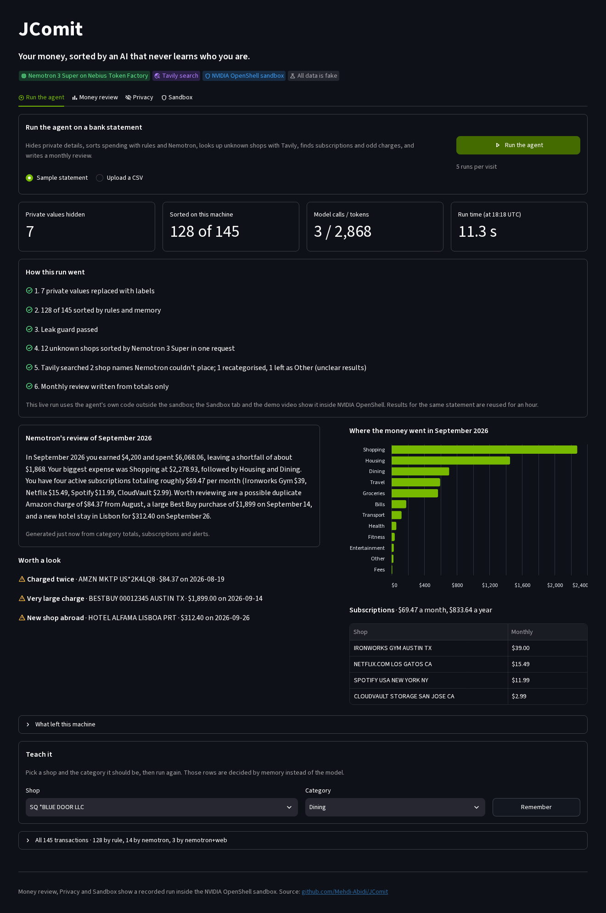
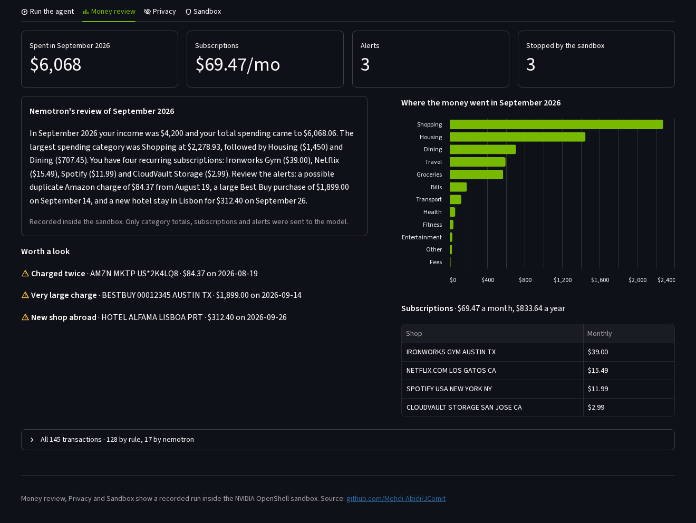
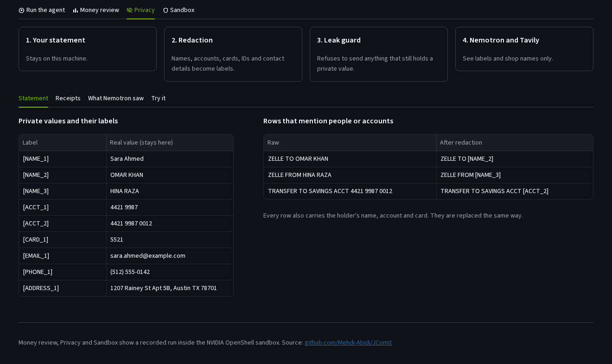
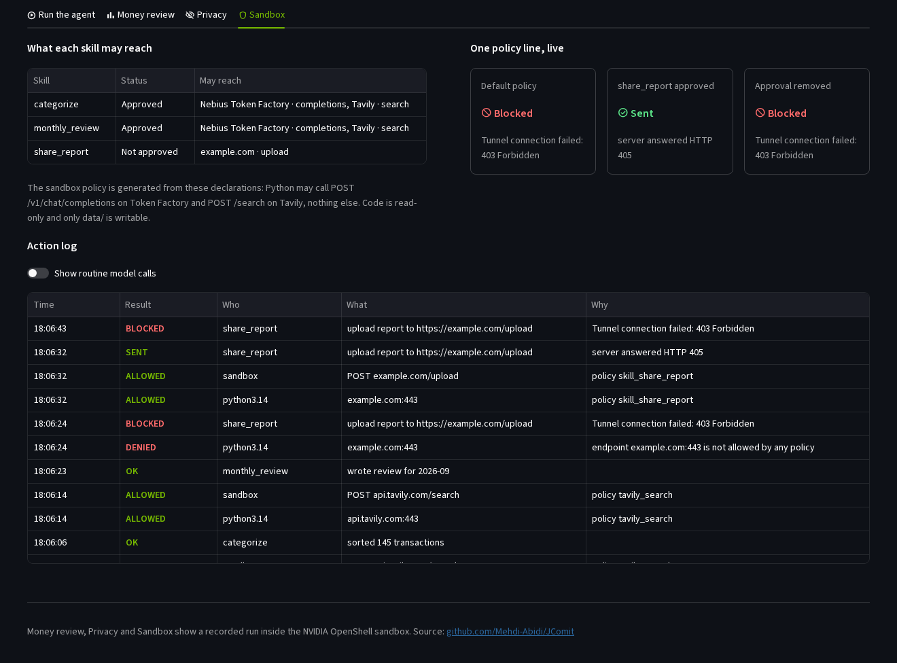

# JComit

JComit is a private personal-finance agent. It reads your bank statements and receipts on your own machine, strips out names, account numbers and card numbers, and only then asks NVIDIA Nemotron for help. The agent runs inside an NVIDIA OpenShell sandbox that can reach Nebius Token Factory and nothing else.

**Live demo:** [jcomit.streamlit.app](https://jcomit.streamlit.app)
**Demo video:** [youtu.be/YVB7yawzkAQ](https://youtu.be/YVB7yawzkAQ)
**Devpost:** TBA

Built for the Nebius x NVIDIA Global AI Hackathon 2026, Personal AI track. All data in this repository is synthetic.

## Contents

- [The problem](#the-problem)
- [What JComit does](#what-jcomit-does)
- [How it works](#how-it-works)
- [How we used NVIDIA and Nebius](#how-we-used-nvidia-and-nebius)
- [Sandbox rules](#sandbox-rules)
- [Screenshots](#screenshots)
- [Run it](#run-it)
- [Project layout](#project-layout)
- [Tests](#tests)
- [Known limitations](#known-limitations)
- [Team](#team)
- [License](#license)

## The problem

AI is good at making sense of spending. Using it, though, usually means uploading a bank statement to someone else's server, with your name, account number and card number on every line. Most people will not do that, and they are right not to.

JComit keeps the statement on your machine. The model sees shop names and labels like `[NAME_1]`, never the person behind them. And because the agent lives in a sandbox, a bug or a prompt injection cannot send your data anywhere the policy does not allow.

## What JComit does

- **Hides private details** before anything leaves the machine. Names, account numbers, IBANs, card numbers, Social Security numbers, dates of birth, emails, phone numbers and addresses become labels such as `[NAME_1]` and `[ACCT_1]`.
- **Sorts spending into categories.** Simple rules handle common shops. Nemotron handles the rest, and when a shop name tells it nothing, the agent looks the name up on the web with Tavily and asks again.
- **Finds subscriptions and strange charges.** On the demo statement it finds 4 subscriptions ($69.47 a month) and 3 alerts: a $1,899 purchase, a double Amazon charge and a first-time hotel abroad.
- **Writes a monthly review** with Nemotron, from category totals only.
- **Remembers your corrections.** Tell it once that Starbucks is a work expense, and it applies that on every later statement, including after a restart.
- **Logs every action**, allowed or blocked, with the reason the sandbox gave.
- **Runs live in the browser.** The demo page runs the real agent on the sample statement or on a CSV you upload, with Nemotron on Token Factory, and shows each step, the tokens used and what the model received.

## How it works

```
 Bank statement (CSV) and receipts
              |
              v
 +--------------------------+      Runs on your machine, inside the
 | 1. Memory and rules      |      NVIDIA OpenShell sandbox
 |    memory.py, RULES      |
 +--------------------------+
              | shops the rules do not know
              v
 +--------------------------+
 | 2. Redaction             |      redact.py: names, accounts, cards,
 |                          |      IDs, contact details -> labels
 +--------------------------+
              v
 +--------------------------+
 | 3. Leak guard            |      guard.py: refuses any payload that
 |                          |      still holds the holder's details
 +--------------------------+
              v
 +--------------------------+
 | 4. Nemotron 3 Super      |      Nebius Token Factory, the only host
 |                          |      the sandbox policy allows
 +--------------------------+
```

On the demo statement, rules sort 128 of 145 transactions. The other 17 come from 12 shops the rules do not know. Nemotron sorts all 12 in a single request, each shop asked once. The model never receives the account holder's name, account number or card number. Rows that name other people, such as Zelle transfers, are sorted by rules on the demo data; if one did reach the model, redaction would have replaced the name first.

Categories are decided in a fixed order: the user's saved corrections, then rules, then Nemotron. When Nemotron answers Other, the agent searches the web for the shop name with Tavily, checks the result with the leak guard, and asks Nemotron again with the search snippets. Only the redacted shop name is searched; a name that still holds a label such as `[NAME_1]` is never searched at all. The page shows which step decided each transaction: memory, rule, nemotron or nemotron+web.

## How we used NVIDIA and Nebius

**NVIDIA Nemotron 3 Super** (`nvidia/nemotron-3-super-120b-a12b`) does the two tasks that need judgement. It sorts shops the rules cannot place, such as Franklin Barbecue (Dining) or a foreign transaction fee (Fees). It also writes the monthly review from category totals, subscriptions and alerts. In testing, sorting a single shop took 138 tokens, a small fraction of a cent.

**Nebius Token Factory** serves Nemotron through an OpenAI-compatible API at `api.tokenfactory.nebius.com`. The client in [src/jcomit/llm.py](src/jcomit/llm.py) uses only the Python standard library, so it runs inside the sandbox, where pip is blocked.

**NVIDIA OpenShell** enforces the boundary:

- Network rules allow two hosts, one program and three paths: Python may call `POST /v1/chat/completions` and `GET /v1/models` on Token Factory and `POST /search` on Tavily. Every other host, program or path is denied.
- Filesystem rules make the code read-only and allow writes only in `/sandbox/data`.
- The Token Factory key is attached as an OpenShell provider. Code inside the sandbox sees a placeholder, and OpenShell injects the real key at the network boundary, so even compromised code cannot read it.
- Every connection is logged with its decision and a reason, for example `endpoint example.com:443 is not allowed by any policy`.

**Tavily**, the agentic search service Nebius agreed to acquire in February 2026, handles shop names Nemotron cannot place. On the demo data, "SQ *BLUE DOOR LLC" is the case it targets. Searches send the shop name only, and the Tavily key is attached as an OpenShell provider in the same way as the Token Factory key ([openshell/tavily-profile.yaml](openshell/tavily-profile.yaml)).

The policy is generated from the skills themselves. Each skill in [src/jcomit/skills.py](src/jcomit/skills.py) declares the network access it needs, and [src/jcomit/policy.py](src/jcomit/policy.py) turns the approved declarations into the OpenShell policy. Approving a skill adds exactly one section to that policy.

| Skill | Approved | Declared access |
|---|---|---|
| `categorize` | Yes | `POST api.tokenfactory.nebius.com/v1/chat/completions`, `POST api.tavily.com/search` |
| `monthly_review` | Yes | `POST api.tokenfactory.nebius.com/v1/chat/completions`, `POST api.tavily.com/search` |
| `share_report` | No | `POST example.com/upload` |

**NVIDIA NemoClaw** installs OpenShell and the agent runtime. Its onboarding step needs systemd to supervise the OpenShell gateway, and GitHub Codespaces has no systemd. We therefore installed NemoClaw with onboarding deferred, started the gateway ourselves ([openshell/start-gateway.sh](openshell/start-gateway.sh)) and ran our own Python skills inside the OpenShell sandbox in place of OpenClaw skills.

## Sandbox rules

[scripts/check_sandbox_rules.sh](scripts/check_sandbox_rules.sh) tests every rule from inside the sandbox and repeats the blocked upload 10 times. Current result:

| Check | Expected | Result |
|---|---|---|
| Write inside `/sandbox/data` | Allow | Pass |
| Write elsewhere in the home folder | Deny | Pass |
| Change the code in `/app` | Deny | Pass |
| Write to `/etc` | Deny | Pass |
| Python calls Token Factory | Allow | Pass |
| curl calls Token Factory (wrong program) | Deny | Pass |
| Python calls Tavily search | Allow | Pass |
| curl calls Tavily (wrong program) | Deny | Pass |
| Python calls webhook.site | Deny | Pass |
| `share_report` uploads the report | Deny | Blocked 10 of 10 |

[scripts/demo_policy_flip.sh](scripts/demo_policy_flip.sh) shows the policy changing on a live sandbox. The upload is blocked under the default policy. Approving `share_report` adds one policy section, and the same upload goes through. Removing the approval blocks it again.

## Screenshots

**Run the agent.** A live run on the sample statement: what was hidden, how each transaction was decided, the model calls and tokens used, and a fresh review from Nemotron.



**Money review.** Nemotron's monthly review, the three alerts, spending by category and the subscriptions it found.



**Privacy.** Each private value and the label that replaces it, and the statement rows that mention other people.



**Sandbox.** What each skill may reach, the same upload blocked, allowed and blocked again, and the action log.



## Run it

### Option 1: the live demo

Open [jcomit.streamlit.app](https://jcomit.streamlit.app) and press **Run the agent**. It runs the real pipeline on the sample statement, or on a CSV you upload, with Nemotron 3 Super on Token Factory and Tavily, and shows each step, the tokens used and exactly what the model received. Teach it a category, run again, and those rows are decided by memory. The Money review, Privacy and Sandbox tabs show a recorded run from inside the OpenShell sandbox, and the "Try it" box redacts any text you type. Free Streamlit apps sleep when idle, so the first visit can take about 30 seconds.

Live runs are capped at 5 per visitor and 300 per day, uploads at 200 KB and 400 rows, and the result for a given statement is reused for an hour. To host your own copy, add `NEBIUS_API_KEY` and, optionally, `TAVILY_API_KEY` to the app's Streamlit secrets.

### Option 2: locally, without the sandbox

Requires Python 3.11 or later.

```bash
git clone https://github.com/Mehdi-Abidi/JComit.git
cd JComit
pip install -r requirements.txt -r app/requirements.txt
python -m pytest
streamlit run app/streamlit_app.py
```

The command line works without a model key for everything except Nemotron:

```bash
PYTHONPATH=src python -m jcomit.cli categorize data/statement.csv --no-ai
PYTHONPATH=src python -m jcomit.cli correct "STARBUCKS #1234 AUSTIN TX" Work
PYTHONPATH=src python -m jcomit.cli memory
PYTHONPATH=src python -m jcomit.finders data/statement.csv
```

To include Nemotron, copy `.env.example` to `.env`, set `NEBIUS_API_KEY`, export it, and drop `--no-ai`.

### Option 3: the full agent in the OpenShell sandbox

Use a GitHub Codespace on this repository. The [dev container](.devcontainer/devcontainer.json) provides Ubuntu 22.04, Docker, Python 3.12 and Node 22.

1. Install NemoClaw and OpenShell with onboarding deferred:

   ```bash
   curl -fsSL https://www.nvidia.com/nemoclaw.sh | \
     NEMOCLAW_NON_INTERACTIVE=1 NEMOCLAW_ACCEPT_THIRD_PARTY_SOFTWARE=1 \
     NEMOCLAW_AGENT=hermes NEMOCLAW_DEFER_ONBOARDING=1 bash
   export PATH="$HOME/.local/bin:$PATH"
   ```

2. Start the OpenShell gateway and register it:

   ```bash
   bash openshell/start-gateway.sh
   openshell gateway add --local --name local https://127.0.0.1:17670
   ```

3. Register Token Factory and Tavily as providers, so the keys stay outside the sandbox. Tavily is optional; without it, shops Nemotron cannot place stay as Other:

   ```bash
   openshell provider profile import --file openshell/nebius-token-factory-profile.yaml
   NEBIUS_API_KEY=<your key> openshell provider create --name nebius --type nebius-token-factory --credential NEBIUS_API_KEY
   openshell provider profile import --file openshell/tavily-profile.yaml
   TAVILY_API_KEY=<your key> openshell provider create --name tavily --type tavily --credential TAVILY_API_KEY
   ```

4. Build the sandbox. This bakes the code into the image, generates the policy from the skills, attaches the provider and uploads the fake data:

   ```bash
   bash scripts/sandbox_up.sh
   ```

5. Run the agent and the checks:

   ```bash
   bash scripts/skill.sh categorize
   bash scripts/skill.sh monthly_review --month 2026-09
   bash scripts/check_sandbox_rules.sh
   bash scripts/demo_policy_flip.sh
   PYTHONPATH=src python3 -m jcomit.actionlog -o data/action_log.json
   ```

To show memory surviving a restart, teach a correction, stop and start the sandbox, and categorize again. Starbucks rows then show `Work`, decided by memory:

```bash
openshell sandbox exec -n jcomit --no-tty -- env PYTHONPATH=/app/src python3 -m jcomit.cli correct "STARBUCKS #1234 AUSTIN TX" Work
openshell sandbox stop jcomit
openshell sandbox start jcomit
bash scripts/skill.sh categorize
```

`scripts/sandbox_up.sh` rebuilds from scratch and clears the sandbox's data, including saved corrections. Use stop and start when you want to keep them.

A simpler sandbox for machines without OpenShell is in [docker-compose.yml](docker-compose.yml). It puts the app on a network with no internet access and routes all traffic through a proxy that allows only Token Factory ([egress/allowlist.txt](egress/allowlist.txt)).

## Project layout

| Path | What it holds |
|---|---|
| [src/jcomit/redact.py](src/jcomit/redact.py) | Redaction: names, accounts, IBANs, cards, SSNs, dates of birth, emails, phones, addresses |
| [src/jcomit/guard.py](src/jcomit/guard.py) | Last check before the model; blocks any payload with the holder's details |
| [src/jcomit/categorize.py](src/jcomit/categorize.py) | Memory, rules and Nemotron, in that order |
| [src/jcomit/memory.py](src/jcomit/memory.py) | Saved corrections in SQLite (`data/memory.db`) |
| [src/jcomit/finders.py](src/jcomit/finders.py) | Subscriptions and strange charges, no model calls |
| [src/jcomit/skills.py](src/jcomit/skills.py) | Agent skills with declared network access |
| [src/jcomit/policy.py](src/jcomit/policy.py) | Generates the OpenShell policy from the skills |
| [src/jcomit/actionlog.py](src/jcomit/actionlog.py) | Merges skill actions with OpenShell's decisions |
| [src/jcomit/llm.py](src/jcomit/llm.py) | Token Factory client, standard library only |
| [src/jcomit/websearch.py](src/jcomit/websearch.py) | Tavily search for shop names, standard library only |
| [src/jcomit/live.py](src/jcomit/live.py) | The full agent run behind the page's Run button |
| [app/streamlit_app.py](app/streamlit_app.py) | The web page |
| [demo/](demo/) | Snapshot of a real sandbox run, shown by the live demo |
| [data/](data/) | Synthetic statements and receipts, made by [scripts/make_fake_data.py](scripts/make_fake_data.py) |
| [openshell/](openshell/) | Sandbox image, generated policy, Token Factory provider profile |
| [docs/](docs/) | Module interfaces, private-detail list, page sketch |

## Tests

196 tests. 194 run anywhere; the 2 page tests run when Streamlit is installed.

| File | Tests | Covers |
|---|---|---|
| `test_redact.py` | 96 | Name formats and accents, separators, cards, IBANs, SSNs, dates of birth, traps such as store numbers |
| `test_finders.py` | 23 | Exactly the planted subscriptions and alerts, plus false positives |
| `test_categorize.py` | 21 | Rules, memory before rules, one request per shop, the leak guard |
| `test_guard.py` | 14 | Private values blocked in any spelling, clean payloads allowed |
| `test_memory.py` | 10 | Merchant keys, corrections surviving a restart |
| `test_policy.py` | 5 | Default policy reaches only Token Factory, only `data/` is writable |
| `test_websearch.py` | 9 | Search queries hold only the shop name, private hints are dropped, failed searches |
| `test_live.py` | 6 | The full run behind the Run button, corrections, web lookups, bad uploads |
| `test_skills.py` | 4 | Skill outputs, the review sending totals only, blocked uploads |
| `test_work_category.py` | 4 | The user-only Work category |
| `test_actionlog.py` | 2 | Parsing real OpenShell log lines |
| `test_app.py` | 2 | The page renders the snapshot; a live run and a taught correction |

## Known limitations

- The redactor finds names by value or by a cue such as "Zelle to". A name with neither is not caught; the leak guard then blocks the payload if it is the account holder.
- The live run on the demo page uses the agent's own code but runs outside the sandbox, because Streamlit Cloud cannot host OpenShell. The sandbox runs in Codespaces or on any Linux host with Docker and OpenShell; the Sandbox tab and the video show it.
- Some shop names are too vague even for a web search. Those stay as Other until the user teaches them.
- In Codespaces the OpenShell gateway has to be started by hand after the Codespace wakes up, because there is no systemd.
- All data is synthetic. JComit has not been tested on real bank exports.

## Team

| Member | Work |
|---|---|
| S. M. Mehdi Abidi ([@Mehdi-Abidi](https://github.com/Mehdi-Abidi)) | Sandbox and policy, categorizer, memory, leak guard, skills, action log, web page |
| Ali Soban ([@ali-soban](https://github.com/ali-soban)) | Synthetic data, redaction and its three hardening rounds, first version of the web page |
| Mufeed Haider ([@MufeedHaider](https://github.com/MufeedHaider)) | Subscription and alert finders, Work category, testing, demo video |
| Taha Zaidi ([@taha-zaidii](https://github.com/taha-zaidii)) | Screenshots and demo recording |

## License

MIT. See [LICENSE](LICENSE).
